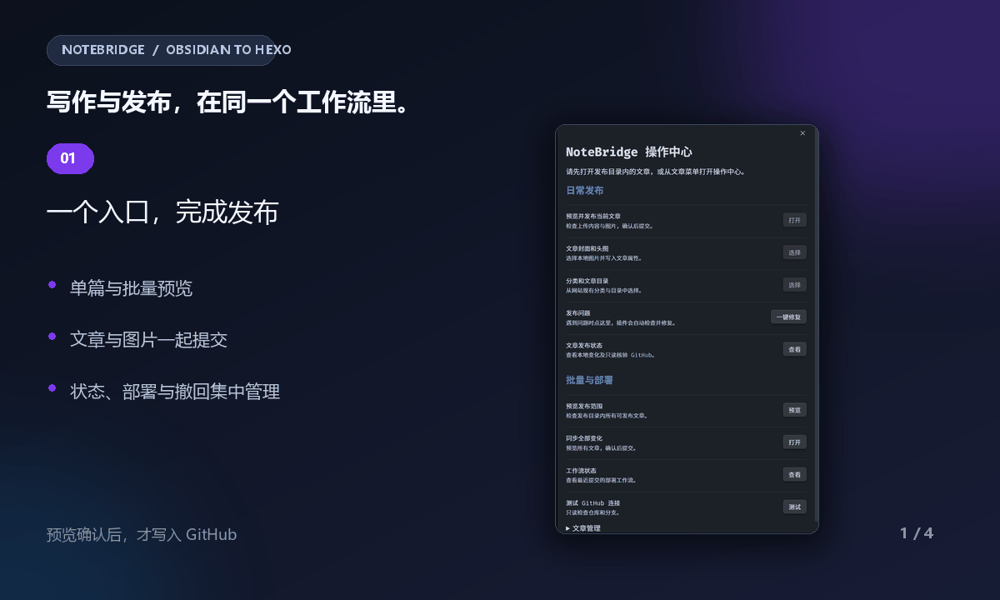
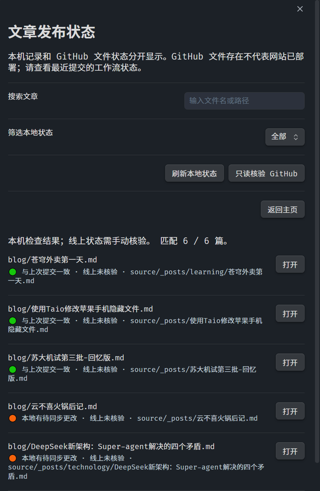
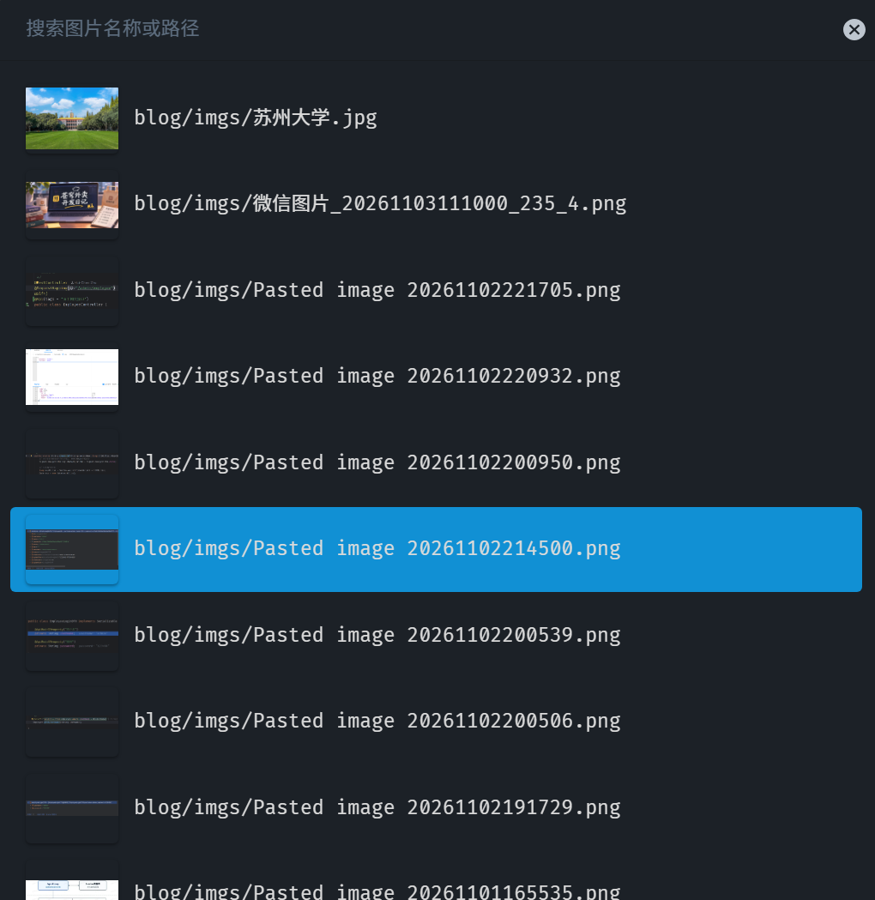
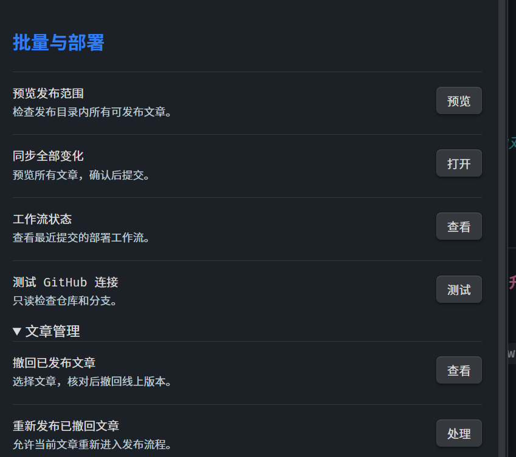

<div align="center">
  <h1>NoteBridge</h1>
  <p><strong>在 Obsidian 中，完成 Hexo 博客发布。</strong></p>
  <p>文章与图片 · 封面与分类 · 状态检查 · 多端同步 · 冲突恢复</p>
  <p>
    <a href="#安装">安装</a> ·
    <a href="#快速开始">快速开始</a> ·
    <a href="#界面预览">界面预览</a> ·
    <a href="#使用指南">使用指南</a> ·
    <a href="#开发与测试">开发与测试</a>
  </p>
  <p>
    
    
    
  </p>
</div>

---

NoteBridge 是一个面向 Hexo 的 Obsidian 发布插件。它将文章转换、图片上传、封面设置、分类选择、状态检查、撤回和部署查询集中到一个操作中心，让你无需离开笔记库，也能清楚完成每一次发布。

> [!IMPORTANT]
> 当前版本为 **0.1.8 开发预览版**，尚未完成 Obsidian 移动端及完整生产环境验收。首次使用请先通过测试 Vault 和隔离 GitHub 仓库验证流程，并备份笔记与发布记录。

<div align="center">
  
  <p><em>从笔记到网站：预览、确认、发布，在同一个工作流里完成。</em></p>
</div>

## 功能一览

| 能力 | 说明 |
| --- | --- |
| 单篇与批量发布 | 发布前展示文章、图片、目标路径和完整上传副本，确认后才提交到 GitHub。 |
| 图片与封面管理 | 收集文章引用的本地图片，通过缩略图选择 Fluid 首页封面和文章页头图。 |
| 分类与目录选择 | 只读扫描 Hexo 仓库已有分类和目录，分别设置网页分类与 Markdown 保存位置。 |
| 状态与部署检查 | 搜索、筛选本地发布状态，只读核验 GitHub 文件，并查询对应提交的 Actions 工作流。 |
| 撤回与重新发布 | 明确核对后撤回线上文章；撤回记录可跨设备同步，恢复发布仍需再次确认。 |
| 多端同步与恢复 | 通过 Vault 同步记录协调多台设备，提供冲突比较、中断核对、备份及损坏记录恢复。 |
| 安全发布 | 检查附件越界、目标冲突、远端变化、目录树截断和未解决合并冲突，无法确认时停止写入。 |
| 无遥测 | 不收集使用数据；GitHub 凭据由 Obsidian SecretStorage 管理，插件设置只保存密钥名称。 |

## 技术栈

<p>
  
  
  
  
  
  
  
</p>

- **界面与平台**：Obsidian Plugin API、Modal、FuzzySuggestModal、SecretStorage。
- **发布与协作**：GitHub Git Data API、Actions API、Hexo 文件结构、Fluid Frontmatter。
- **语言与工程**：TypeScript、Node.js、esbuild、ESLint、Node.js 原生测试框架。
- **文档展示**：本地 PNG 截图与 GIF 动画，不依赖 JavaScript 或 Lottie 播放器。

## 安装

### 环境要求

- Obsidian **1.11.4 或更新版本**。
- 一个用于 Hexo 源码的 GitHub 仓库。
- 具有目标仓库权限的 GitHub fine-grained personal access token。

### 手动安装

1. 下载仓库根目录的 [manifest.json](manifest.json)、[main.js](main.js) 和 [styles.css](styles.css)。
2. 将三个文件放入 Vault 的 `.obsidian/plugins/notebridge/` 目录。
3. 重启 Obsidian，在“设置 → 第三方插件”中启用 **NoteBridge**。
4. 更新插件时同时替换这三个文件，确保它们来自同一版本。

最终用户不需要安装 Node.js、Git 或独立服务器；只有参与开发时才需要 Node.js。

## 快速开始

### 1. 准备 GitHub 凭据

创建仅访问目标仓库的 fine-grained PAT，并授予：

- **Contents: Read and write**：读取和发布文章、图片。
- **Actions: Read-only**：可选，用于查询部署工作流。

在 Obsidian 密钥存储中添加 token，再到 NoteBridge 设置中选择对应凭据。不要把 token 写入笔记、同步记录或聊天内容。

### 2. 配置发布路径

| 设置 | 默认值 | 用途 |
| --- | --- | --- |
| GitHub 仓库 | 空 | 格式为 `所有者/仓库`。 |
| 源码分支 | `main` | Hexo 源码所在分支。 |
| 发布根目录 | `blog` | Obsidian 中允许发布的笔记目录。 |
| 文章目标目录 | `source/_posts` | Hexo Markdown 保存位置。 |
| 图片目标目录 | `source/imgs` | Hexo 图片保存位置。 |
| 站点 root | `/` | 网站部署的子路径。 |
| 图片公开 URL 路径 | `imgs` | 上传副本使用的图片公开路径。 |
| 部署工作流文件 | `pages.yml` | 需要查询的 GitHub Actions 工作流。 |

### 3. 发布第一篇文章

1. 将文章放入 `blog/`，本地图片放入 `blog/imgs/`。
2. 点击左侧 NoteBridge 图标，或从文章右键菜单打开“NoteBridge：操作中心”。
3. 选择“预览并发布当前文章”，检查上传内容、图片和目标路径。
4. 点击“测试 GitHub 连接”确认仓库与分支可用。
5. 确认预览后提交，再通过“工作流状态”检查部署进度。

**NoteBridge 不会自动发布。每一次 GitHub 写入都需要你明确确认。**

## 界面预览

<table>
  <tr>
    <td align="center" width="33.33%"><strong>文章发布状态</strong></td>
    <td align="center" width="33.33%"><strong>封面图片选择</strong></td>
    <td align="center" width="33.33%"><strong>批量与文章管理</strong></td>
  </tr>
  <tr>
    <td align="center" valign="top">
      
    </td>
    <td align="center" valign="top">
      
    </td>
    <td align="center" valign="top">
      
    </td>
  </tr>
</table>

## 使用指南

### 封面和头图

“Fluid 文章封面和头图”默认开启。打开文章后，在操作中心选择“文章封面和头图”，即可通过缩略图选择图片，并设置为：

- `index_img`：首页文章封面。
- `banner_img`：文章页头图。
- 同时使用封面和头图。

也可以手动填写 Frontmatter：

```yaml
---
index_img: "[[imgs/封面图.png]]"
banner_img: "[[imgs/封面图.png]]"
---
```

本地图片必须位于发布根目录内的 `imgs/` 文件夹。保存选择只修改本地文章属性，之后仍需预览并发布；图片缺失、路径越界或目标冲突会阻止上传。实际显示效果取决于 Fluid 主题配置。

### 分类和文章目录

插件只读扫描仓库已有文章的 `categories` 或 `category` 属性，并列出文章目标目录下的现有文件夹：

- **网页分类**会替换当前文章的原有分类。
- **仓库目录**决定 Markdown 文件的保存位置。
- 两者分别设置，保存后仍需预览并手动发布。
- 已发布文章的远端路径保持固定，不能通过目录选择器直接迁移。

### 状态与部署

“文章发布状态”支持按路径搜索和按本地状态筛选，最多显示前 200 条结果。插件分别展示本地记录与 GitHub 核验结果，避免把“GitHub 文件存在”误认为“网站已经部署”。

提交后，插件按本次 SHA 查询指定工作流，每 15 秒检查一次，最多持续 10 分钟。工作流成功只代表对应运行成功，仍需确认其中包含实际部署步骤。

### 撤回与重新发布

撤回前会显示本地文章、远端路径和目标分支，确认后才创建删除提交。本地文件与远端图片会保留，旧内容仍存在于 Git 历史中。

撤回事件会写入同步记录，防止旧设备快照恢复已撤回的关联。需要重新发布时，先完成各设备同步，再在操作中心的“文章管理”中明确允许重新发布，随后重新预览并提交。

### 冲突处理与恢复

当远端文章与本机基线不一致时，运行“比较并合并当前文章的发布冲突”：

1. 对比上次发布版本、本次上传副本和 GitHub 当前版本。
2. 自动合并不重叠的修改，手动处理冲突标记。
3. 检查合并结果并进入发布预览。
4. 提交前再次核对远端版本和本地原文。

合并只修改上传副本，不会直接覆盖 Obsidian 本地笔记。操作中心的“一键修复”可处理能够安全确认的记录与中断；无法安全判断时会要求人工核对，不会强行覆盖远端文件。

## 多设备同步与数据安全

- 每台设备都需要安装相同版本的插件，并分别配置 GitHub 凭据。
- 插件在 Vault 根目录的 `NoteBridge同步记录/` 中保存各设备记录，可通过坚果云等工具同步。
- 同步记录包含仓库配置、文章与图片路径、发布哈希；冲突合并记录还可能包含已发布文本，但不包含 token。
- 首次预览会为文章写入随机 `notebridge_id`，用于识别重命名和跨设备记录；该字段不会进入上传副本，请勿复制或手动删除。
- 每次写入同步记录前会保留 `.backup`；损坏记录需要明确恢复，不能通过删除记录绕过检查。
- 发布前请等待文章、图片和同步记录完成同步。插件无法替代同步工具，也无法自动解决两端同时编辑造成的笔记冲突。

<details>
<summary><strong>查看完整发布规则与当前限制</strong></summary>

### 文章与附件范围

- 只扫描发布根目录下的 Markdown，排除任何层级 `imgs` 内的 Markdown。
- `draft: true`、`publish: false`、`published: false` 的文章会跳过。
- 支持 png、jpg、jpeg、gif、webp、svg、avif；只上传发布根目录内 `imgs/` 中被引用的本地图片。
- HTTP(S) 图片保留原样，不会由插件下载或上传。
- 附件缺失、路径越界、目标碰撞、远端变化或目录树截断会阻止发布。
- 相同内容不会生成新提交；空目录不会被当作删除文章的依据。

### Markdown 转换

- 默认移除 Obsidian `%%...%%` 注释和 HTML 注释，保留代码块、行内代码和 Hexo 的 `<!-- more -->`。
- 未闭合注释会阻止发布；`<!-- more -->` 不应包含私密内容。
- 支持简单 Markdown 图片和 Obsidian 图片嵌入，上传副本会移除尺寸标记。
- 复杂图片、引用式图片、普通 Obsidian 文章链接、笔记嵌入及 HTML 图片会报错。
- 相对 Markdown 笔记链接不会自动改写，预览时需要人工核对网站路径。
- 不支持 Dataview 渲染；自定义公开字段中的图片不提供通用识别。
- `cover`、`banner`、`thumbnail` 字段会阻止发布，请使用插件支持的 Fluid 字段。

### Frontmatter 与提交

- 默认公开字段为 `title`、`date`、`updated`、`tags`、`categories`、`permalink`。
- 控制字段和 `notebridge_id` 始终从上传副本移除。
- 缺少 `title` 时使用文件名；首次准备日期会保存在本机状态中。
- `updated` 只保留原值，不会自动计算当前时间。
- 插件使用 Git Data API 创建 blob、tree、commit，并以非强制方式更新分支。
- 写请求串行执行且开始时间至少间隔 1 秒；限流或结果不明确时不会盲目重试。
- 不会自动删除远端文件；撤回必须单独核对并确认。

### 尚未覆盖的能力

- 未实现自动监听、持久化发布队列、自动退避重试和暂停/恢复。
- 复杂 Markdown、并发提交、网络超时及部署工作流仍需端到端验证。
- 移动端尚未完成实机验收。
- 首页排序由 Hexo 和主题管理，NoteBridge 不修改网站排序脚本。

</details>

## 故障排查

| 情况 | 建议操作 |
| --- | --- |
| 远端文章与基线冲突 | 打开文章，比较三个版本并合并；不要通过删除同步记录强行覆盖。 |
| 本地或远端附件缺失 | 补齐文件后重新预览，确认图片位于发布根目录内的 `imgs/`。 |
| 返回 401 或 403 | 检查 token、仓库范围以及 Contents / Actions 权限。 |
| `ERR_CACHE_READ_FAILURE` | 插件会对只读请求绕开缓存重试一次；仍失败时在分类窗口点击“重新读取”或重启 Obsidian。 |
| 提交结果无法确认 | 不要盲目重试，先核对 GitHub，再使用操作中心的恢复与修复能力。 |
| 存在旧重复发布记录 | 等待各设备同步后，比较两个远端版本，确认属于同一文章再清理旧关联。 |
| 远端旧记录已不存在 | 使用“核对远端已删除的旧发布记录”，确认不是尚未同步的改名文章后清理关联。 |

## 更多文档

- [功能与逻辑说明](docs/NoteBridge功能与逻辑说明.md)
- [发布前核查](docs/发布前核查.md)
- [0.1.7 更新说明](docs/NoteBridge-0.1.7更新说明.md)
- [历史评估与优化建议](docs/NoteBridge评估与优化建议-2026-11-01.md)

## 开发与测试

```bash
npm ci
npm test
npm run build
npm run lint
```

- 测试通过 mock GitHub 请求运行，不访问生产仓库。
- 当前测试覆盖文章转换、图片处理、同步、合并、撤回、恢复和操作中心导航。
- 构建输出为根目录的 `main.js`，安装时还需 `manifest.json` 和 `styles.css`。
- 自动化测试不能替代 Obsidian 实机、复杂 Markdown、网络异常及部署工作流验证。

## 网络与隐私

NoteBridge 使用 `api.github.com` 读取配置的仓库、分支和 Actions 状态，并在确认后写入选中的文章转换副本和图片。发布基线与首次准备日期保存在 Obsidian localStorage 和 Vault 同步记录中。插件不提供遥测；远端内容和 Git 历史由 GitHub 及你的仓库权限管理。

## 许可

NoteBridge 使用 [Apache License 2.0](LICENSE)。打包组件及其许可证见 [THIRD_PARTY_NOTICES.md](THIRD_PARTY_NOTICES.md)。
